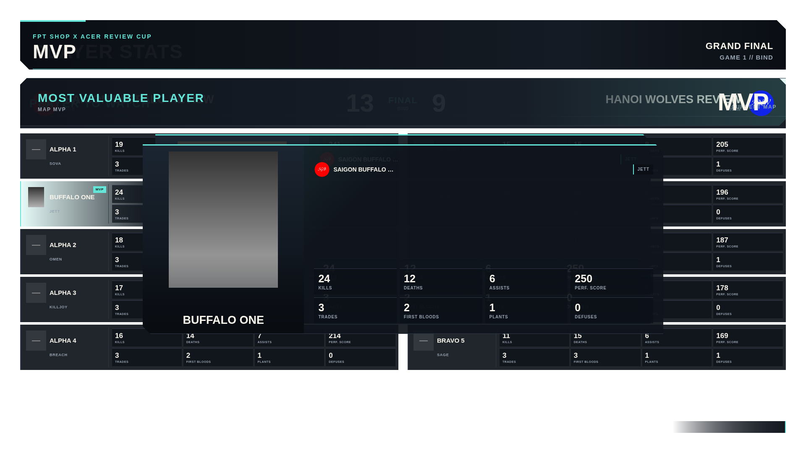
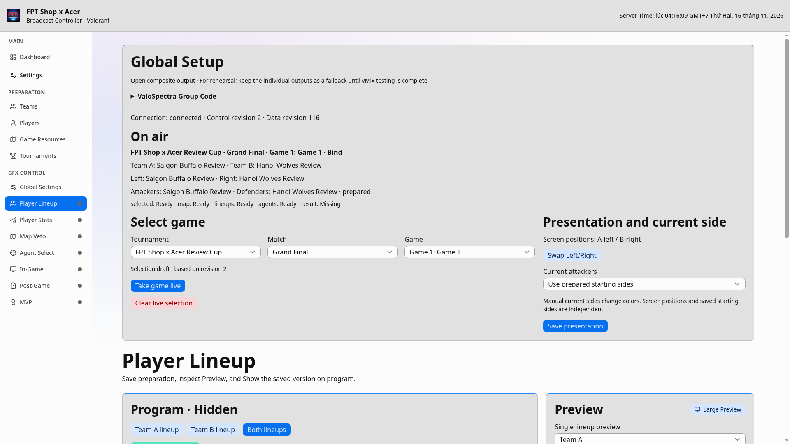
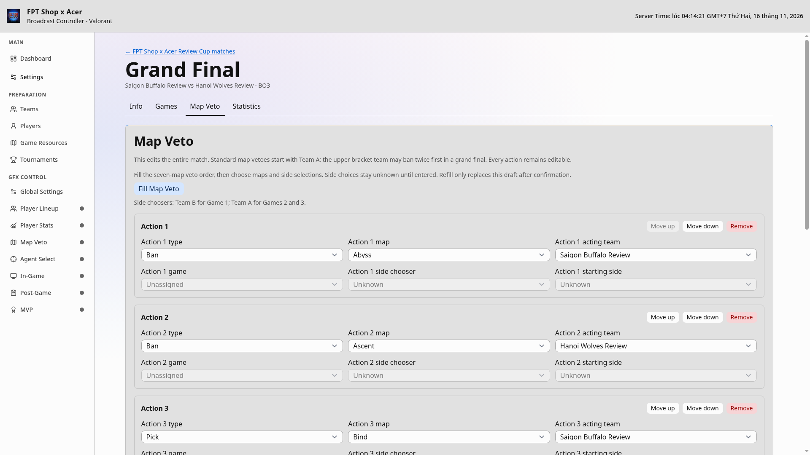

# Usability review — 2026-11-16

An operator walk-through of the admin pages, done by driving the real production build in a browser from an empty catalogue to a finished Game 1 and a prepared Game 2. It complements the automated [QA baseline](./QA-BASELINE.md): that page says the code does what the tests expect; this page says what it is like to run a show with it.

| Item     | Value                                                                                               |
| -------- | --------------------------------------------------------------------------------------------------- |
| Commit   | `6e464aa` plus the uncommitted changes listed in the QA baseline                                    |
| Build    | `pnpm build` with `ORIGIN=http://localhost:4300`, started with `node build`                         |
| Browser  | Playwright bundled Chromium 159, headless, 1920×1080 viewport, driven step by step                  |
| Data     | Throwaway database, asset folder and settings key in a temporary directory; three demo teams seeded |
| Internet | Used once, for the Game Resources sync from VALORANT-API                                            |

`local.db` was not touched. No Spectra, GStack or HenrikDev service was contacted, and nothing was run in OBS or vMix. One person operated one controller; two-operator behaviour is covered by the automated conflict tests, not by this review.

## Verdict

The preparation flow is solid and can be learned in one sitting. The live graphics controls work and respond in about 100 ms. Four things should be dealt with before the event, because each can cost time or put something wrong on air:

1. In one browser, only three of the seven output URLs load. The rest hang.
2. Saving the Game MVP makes the post-game statistics you have typed impossible to save.
3. Several full-screen graphics can be on air at once, with no warning and no single control to clear them.
4. On every graphic page the Show/Hide button is below the first screen at 1080p.

## What was done

| Step | Action                                                                                    | Result                                       |
| ---- | ----------------------------------------------------------------------------------------- | -------------------------------------------- |
| 1    | Created two teams with three logos each; tried an empty form, a fake image, a duplicate   | Works; see findings 7 and 9                  |
| 2    | Created players with portrait and Riot ID; tried a malformed and a duplicate Riot ID      | Works; see finding 7                         |
| 3    | Synced maps, agents and weapons                                                           | 13 maps, 30 agents, 21 weapons in about 30 s |
| 4    | Created a tournament, added both teams, filled two six-player rosters, saved a 7-map pool | Works                                        |
| 5    | Created a BO3 match, filled and saved the veto, created Game 1, lineup, agents            | Works; see findings 5 and 7                  |
| 6    | Took Game 1 live; showed and hid all seven graphics; edited a lineup while it was on air  | Works; see findings 1, 3 and 4               |
| 7    | In-Game: tactical timeout, finish, round ceremony                                         | Works                                        |
| 8    | Finalized 13–9 after trying 13–13 and 7–5; typed 80 statistics; picked the MVP            | Works; see finding 2                         |
| 9    | Duplicated Game 1 into Game 2 and took it live                                            | Works                                        |
| 10   | Stopped the server while a graphic was shown, then restarted it                           | Recovers by itself; see finding 8            |

## Findings

### High

#### 1. Only three output URLs load per browser

Every output page, and every graphic control page, keeps two permanent event streams open (`/api/broadcast/events` and `/api/live-game/events`). Browsers allow six connections per host over plain HTTP, shared by all tabs of that browser.

- Opening the seven `/gfx/live/<graphic>` URLs in one browser: Player Lineup, Player Stats and Map Veto rendered and received data. Agent Select, In-Game, Post-Game and MVP never loaded.
- With the composite output open in a second tab, **Show Agent Select** stayed on "Saving…" for about 60 seconds. The request reached the server the moment the other tab was closed. The button gave no timeout or error in that time.
- Two controller tabs on graphic pages plus one output tab is already enough to hit the limit.

OBS and vMix were not tested here. Their browser sources are Chromium-based, and sources inside one OBS instance normally share one connection pool, so the seven individual URLs are likely to behave the same way there. The README currently names the individual URLs as the rehearsed fallback for the composite output; with two streams per page that fallback cannot hold seven sources.

- **For this event:** use `/gfx/live/composite` (two streams in total) for program, keep the controller in a different browser from any output preview, and test the exact OBS/vMix scene on the event machine before relying on it.
- **Proper fix:** send both event types down one stream, or open the live-game stream only on pages that render live telemetry. Either halves the connection count; serving over HTTP/2 removes the limit.

#### 2. Saving the MVP blocks the statistics you just typed

On a game's **Post-Game Report** tab, type statistics, click **Save Game MVP**, then click **Save post-game statistics**. The second save is rejected with "The game changed. Reload and review before saving." Retrying gives the same answer. The only way forward is **Reload this section**, which discards all 80 typed values.

This is the stale-save protection reacting to the operator's own save in a neighbouring section. It was reproduced with a single operator and a single tab.

- **For this event:** save the statistics table first, then the MVP.
- **Fix:** do not treat a save from another section of the same page as a conflict for unrelated fields, or let the operator keep the draft and re-submit it against the new revision.

#### 3. Full-screen graphics stack with no warning and no "hide all"

Post-Game, Player Stats and MVP were all shown at once. The composite output drew them on top of each other and was unreadable.



Nothing warns when a second full-screen graphic is shown, and there is no single control to clear program. Clearing three graphics means visiting three pages and finding the Hide button on each. The sidebar dots do show which graphics are on air, which helps.

- **Fix:** add a "Hide all" control next to the sidebar or in Global Setup, and warn (or ask) when showing a full-screen graphic while another is on air.

#### 4. Show and Hide are below the first screen

On all seven graphic pages, the shared Global Setup panel takes the first 830 px. At 1920×1080 the Show button sits at y ≈ 1076, so every page opens with its main control out of sight.



Global Setup is needed once per game; Show/Hide is needed constantly.

- **Fix:** collapse Global Setup on the graphic pages to its one-line "On air" summary, since the full version already has its own page, and put Program controls and Preview first.

### Medium

#### 5. Map Veto is slow to run live

- The veto editor is about 3,100 px tall: seven action cards of roughly 215 px each, with **Save match veto** at the very bottom.
- A shown graphic keeps its published copy, so revealing each ban or pick as it happens means edit, scroll, save, scroll, Hide, Show. The graphic leaves the screen each time.
- A map chosen in an earlier action disappears from later dropdowns, so swapping two maps needs a third, temporary choice.



- **Fix:** a compact one-row-per-action layout with a sticky Save, and an "update on air" action that republishes without hiding.

#### 6. Jumping between graphic pages by URL can stall for half a minute

Loading graphic pages by address (bookmark, pasted link, new tab) several times in a row made the next page wait 12 to 37 seconds. The page request itself was queued behind connections left open by the previous pages. Sidebar navigation stayed at about 100 ms and five consecutive F5 reloads were normal, so everyday use is unaffected. It is the same connection limit as finding 1 and the same fix applies.

A few early navigations in this review also hung for no reason I could pin down; they are most likely the same effect.

#### 7. Catalogue data is not checked for mistakes that matter later

| Input                                  | Result                    | Why it matters                                              |
| -------------------------------------- | ------------------------- | ----------------------------------------------------------- |
| Riot ID `not a riot id`                | Saved                     | HenrikDev import looks players up by saved Riot ID          |
| Same Riot ID on two players            | Saved, no warning         | Import mapping becomes ambiguous                            |
| Second team with the same name and tag | Saved, no warning         | Two identical entries in every team picker                  |
| Same agent for two players on one team | Saved, no warning         | Impossible in a real game; goes to Agent Select graphic     |
| Lineup slot dropdowns                  | Still list picked players | Unlike the veto map lists; the duplicate case was not tried |

- **Fix:** validate the `name#tag` shape, and warn (not block) on duplicates.

#### 8. A dropped server is easy to miss

- With the server stopped, a Hide attempt answered "Could not save. Your draft is still here. Reload and review before retrying." That is clear.
- The connection state is only the small line "Connection: reconnecting" inside Global Setup. There is no banner.
- For about 30 seconds after the stop signal, while the server was finishing its shutdown, the controller still said "connected" and the header clock kept running.
- After the restart the controller reconnected by itself, the shown graphic was still marked Shown, and Hide worked. The "Reload and review" message stayed on screen although a plain retry was enough.

- **Fix:** show a page-wide warning whenever the stream is not connected, and clear the save error on reconnect.

#### 9. Teams and Players forms lose work quietly

- Clicking **Add team** while editing another team discards the unsaved edit without asking. The tournament workspaces do keep drafts; these two pages do not.
- **Delete unused team** deletes on the first click, with no confirmation.
- After a successful create there is no "Saved" message; the form just switches to edit mode.
- After a rejected upload the page reloads with all three file choices cleared, and the error ("Use a PNG, JPEG, or WebP image.") does not say which file was wrong.

### Low

- The Dashboard labels steps 2 to 4 of the production flow "Coming soon" although tournaments, matches and graphics are all implemented, and it has no Tournaments card. Teams shows an "Import coming soon" badge.
- Pickers show internal IDs: `Buffalo One (7bbbe1cb-35c1-…)` in lineups and rosters.
- A game created with the default name reads "Game 1: Game 1" in the live selector, and the selector does not mark finished games.
- A finished game's status is shown as "normal".
- On air, the decider card in Map Veto says "TEAM UNAVAILABLE", and the MVP card cut the team name to "SAIGON BUFFALO …" with room to spare.
- A lineup is ten separate dropdowns with no "fill from roster".
- Tabs with unsaved changes are not marked, although the draft is kept.
- The Game Resources tab is not kept in the address, so a reload returns to Maps.
- Tournament teams are listed alphabetically, not in the order added.
- The finalize confirmation appears before the score is validated, so an invalid score is confirmed and then rejected.
- The header clock follows the browser locale (it showed Vietnamese date text beside an English interface).
- The browser console logs a Svelte `derived_inert` warning when a game page opens, in the production build too.

## What works well

- Show and Hide answered in about 100 ms and the output followed immediately.
- "Preview contains newer saved data or controls. Hide → Show to publish." appears as soon as saved data is newer than what is on air.
- The live game cannot be changed or cleared while any graphic is shown, and the page says why.
- Score entry: clear rule text for invalid finals, a confirmation that states the current series, and the series header updating to 1–0.
- Game 1's map and starting sides came straight from the saved veto, with a note saying where to change them.
- Roster search states "Assigned to Saigon Buffalo Review" instead of offering a player twice.
- Resource sync shows per-item progress and a final count.
- Duplicate Game copied the lineup, left agents and results empty, and picked up Haven from the veto.
- In-Game blocks a new ceremony during a pause and offers **Finish Timeout** in its place.
- Drafts survive tab switches inside the tournament, match and game workspaces.
- After a server restart the controller and the shown state recovered without a reload.

## Not covered

- OBS and vMix browser sources, including the connection limit in finding 1 on the event machine.
- Real Spectra, GStack and HenrikDev sessions, external HUD mapping, and provider imports.
- Two operators working at once, keyboard-only operation, screen readers, and small or portrait screens.
- Windows, the event database, and long sessions.
- Final supplied artwork; all outputs used the generic test templates.
- Whether Player Stats can be shown with no player selected; the attempt was interrupted.

## How to reproduce

Use a throwaway database and asset folder, never `local.db`.

```sh
export DATABASE_URL=file:/tmp/vlr-review/review.db
mkdir -p /tmp/vlr-review/assets
pnpm db:migrate && node scripts/seed.mjs
ORIGIN=http://localhost:4300 pnpm build
ASSET_DIR=/tmp/vlr-review/assets SETTINGS_ENCRYPTION_KEY_FILE=/tmp/vlr-review/settings.key \
  LIVE_PROVIDER_CONFIG_FILE=/tmp/vlr-review/live-provider.json \
  HOST=127.0.0.1 PORT=4300 node build
```

The build is tied to the `ORIGIN` it was made with. Rebuild with the real address before running the app for the event.

- **Finding 1:** open all seven `/gfx/live/<graphic>` URLs as tabs of one browser window and count how many render.
- **Finding 2:** on a game with a saved lineup, type any statistic, click **Save Game MVP**, then **Save post-game statistics**.
- **Finding 3:** show Post-Game, Player Stats and MVP, then open `/gfx/live/composite`.
