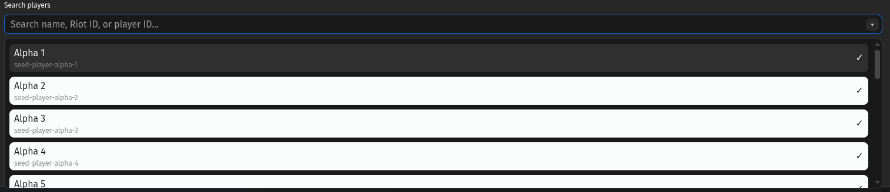

## Fixing the dropdown of the Tournament -> Teams and Players interface

## Problem

- Currently the Tournaments / Open Tournament Workspace / Teams and Players page, where it is used to manage tournament participants, is hella slow to work with. 
    - Dropdown itself is too small:
    
    - You can multi-select, but as soon you search another player in the text box, all the previous multi-select is gone.
    - Feels unfriendly and awkward to use.

## Goal

- Fix the manage tournament participant UI to make it faster and friendly to work with.