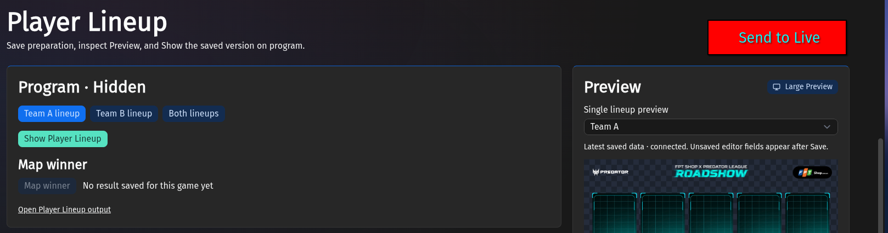
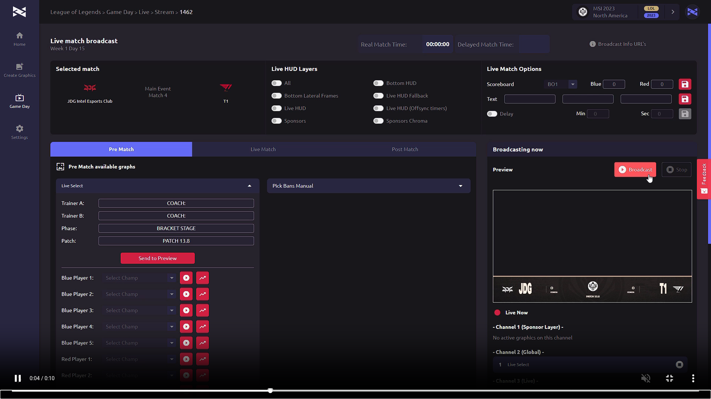

# Proper composite output

## Problem

- Composite gfx output is a bit broken, this is the feature that was not flushed out properly.
- When all GFXes are enabled at the same time, they overlay on top of one another. Other GFX software would allow you to do that, but most of the GFX in this app are full screen ones. (except the Agent Select)

## Goal

- Example: Add an additional button, take to live like so to send it to the Composite (Live) output.
    
- Allow opt-in if GFXes are allowed to overlay on top of another.
- If they are supposed to be overlayed for some reason, like tickers or Lower Thirds, allow it, otherwise Full Screen type GFXes will animate the old graphics out of air before animating the new one.

## Inspiration

- All Character Generation software/hardware.
- Barracks.gg control interface: 
  - Granted they have multiple channels for multiple graphics on the main output overlay, but this patch is already allow GFXes to opt-in on overlaying over each other.
